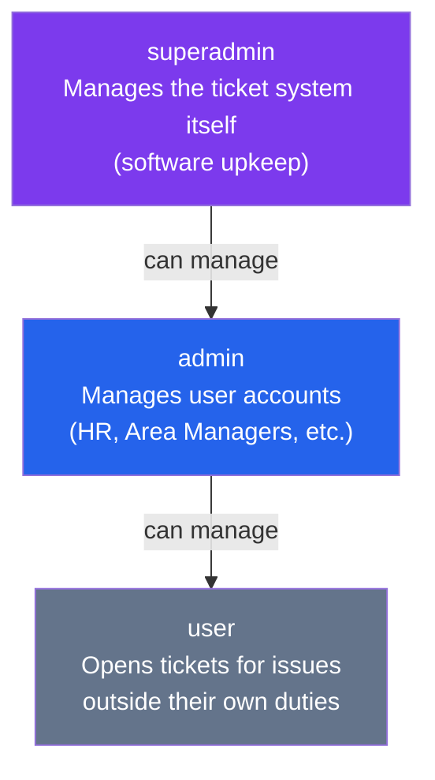
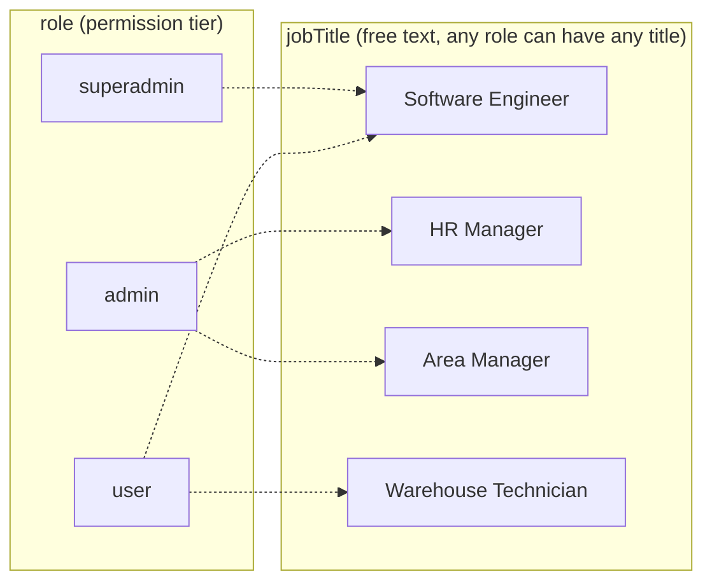

# Role vs. Job Title — Design Rationale

**Purpose of this document:** explain why the ticket system's user model
needs two separate fields — `role` and `jobTitle` — instead of one, and
what each one is responsible for.

---

## The core distinction

| | `role` | `jobTitle` |
|---|---|---|
| **Answers the question** | "What can this person *do* in the ticket system?" | "What does this person *do* at the company?" |
| **Type** | Fixed, small set of system-defined values | Free-form, company-defined text |
| **Who can change it** | Superadmin (promotions), Admin (limited) | Admin / Superadmin, for any account |
| **Example values** | `user`, `admin`, `superadmin` | `"HR Manager"`, `"Area Manager"`, `"Software Engineer"`, `"Warehouse Technician"` |
| **Effect on permissions** | Directly controls access | None — purely informational |
| **Effect on frontend display** | Minimal (maybe a badge) | Drives ticket-assignment UI, "who does what" browsing |

---

## Why one field isn't enough

### If we only had `role`

We'd be forced into a bad tradeoff:

- **Make `role` very granular** (`hr_manager`, `area_manager`, `it_admin`, `software_engineer`, ...) → every new job title at the company requires a backend code change, and we end up writing permission logic for dozens of role variants that all behave identically from the system's point of view.
- **Keep `role` generic, lose the job info** → the frontend has no way to show *"this ticket needs an HR person"* or let someone filter *"show me all Area Managers"* when assigning a ticket — that information simply wouldn't exist anywhere.

### If we only had `jobTitle`

Job titles don't map cleanly to permissions:

- An **HR Manager** and an **Area Manager** are different jobs, but both need `admin`-level access to this system. Driving permissions off job title means hardcoding "HR Manager = admin", "Area Manager = admin", and every future title that also needs admin access — an ever-growing list baked into business logic that shouldn't need to know what an "Area Manager" even is.
- A **Software Engineer** might need `superadmin` (if they maintain the ticket system) or just `user` (if they only report unrelated IT problems) — identical job title, completely different required system permission.

---

## The hierarchy

`jobTitle` sits *orthogonally* to this hierarchy — it never determines where
someone sits in it:

*(Note how "Software Engineer" appears on both sides — the same job title
can carry a different `role` depending on whether that specific person
maintains the ticket system or just uses it.)*

---

## Full permission matrix (by `role`)

| Action | superadmin | admin | user |
|---|:---:|:---:|:---:|
| View any user's data (excl. password) | ✅ | ✅ | ✅ |
| Create a new user account (role always defaults to `user`) | ✅ | ✅ | ❌ |
| Edit `name` / `email` / `birthDate` / `jobTitle` — own account | ✅ | ✅ | ❌ |
| Edit `name` / `email` / `birthDate` / `jobTitle` — `user`-role accounts | ✅ | ✅ | ❌ |
| Edit `name` / `email` / `birthDate` / `jobTitle` — `admin`-role accounts | ✅ | ❌ | ❌ |
| Change the `role` field (promote/demote) | ✅ | ❌ | ❌ |
| Change password — own account | ✅ | ✅ | ✅ |
| Change password — `user`-role accounts | ✅ | ✅ | ❌ |
| Change password — `admin`-role accounts | ✅ | ❌ | ❌ |
| Delete a `user`-role account | ✅ | ✅ | ❌ |
| Delete an `admin`-role account | ✅ | ❌ | ❌ |
| Delete a `superadmin` account | ❌ (DB-only) | ❌ | ❌ |

**Notes:**
- Passwords are never *viewable* by anyone, including developers — they're
  stored as a one-way bcrypt hash. "Change password" permissions above refer
  to *setting* a new password, not viewing the existing one.
- `superadmin` accounts are created directly in the database, not through
  the API — there is no signup path for this tier.
- Promotion between tiers (`user` → `admin`, `admin` → `superadmin`) is a
  manual action by a superadmin. The *process* of requesting a promotion
  (e.g. opening a ticket asking for one) is a company convention, not
  something the system enforces mechanically.

---

## Who typically holds each role, by job function

| Role | Typical job titles | Why |
|---|---|---|
| **superadmin** | Roles tied to building/maintaining the ticket system itself (e.g. internal software engineers, IT infrastructure owners) | Needs full system control to keep the software running |
| **admin** | HR Manager, Area Manager, and similar roles that aren't about the ticket system itself, but require managing *who* can use it | Needs to manage user accounts as part of their broader people-management duties |
| **user** | Anyone whose job isn't the ticket system or user management — they just need to report problems outside their own responsibilities | Only needs to open tickets, not manage the system or other accounts |

---

## Summary

- **`role`** is small, fixed, and controls *permissions*. Changing it is a
  deliberate, restricted action.
- **`jobTitle`** is free-form, company-defined, and purely *descriptive*.
  It exists so the frontend can show meaningful information when routing
  or assigning tickets — it has no bearing on what a person is allowed to
  do in the system.
- Keeping them separate means the backend's authorization logic stays
  simple and stable (three roles, clear rules) while the company can
  freely rename, add, or retire job titles without ever touching
  permission code.
